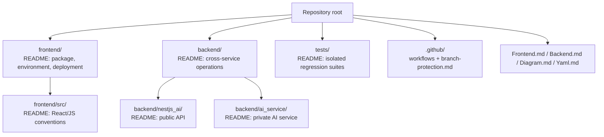
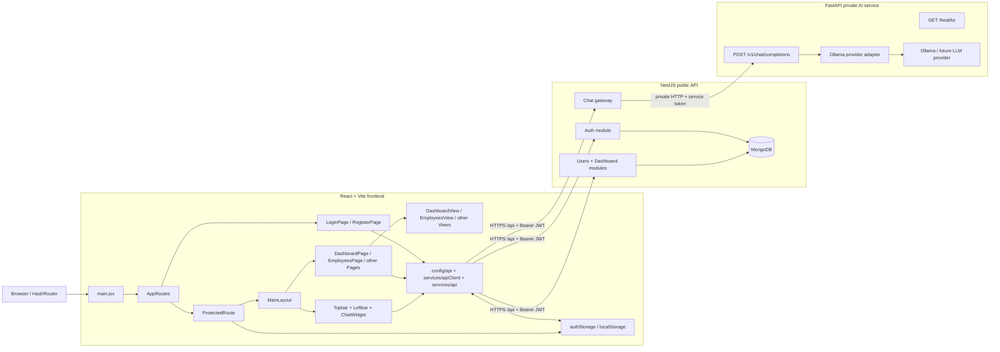
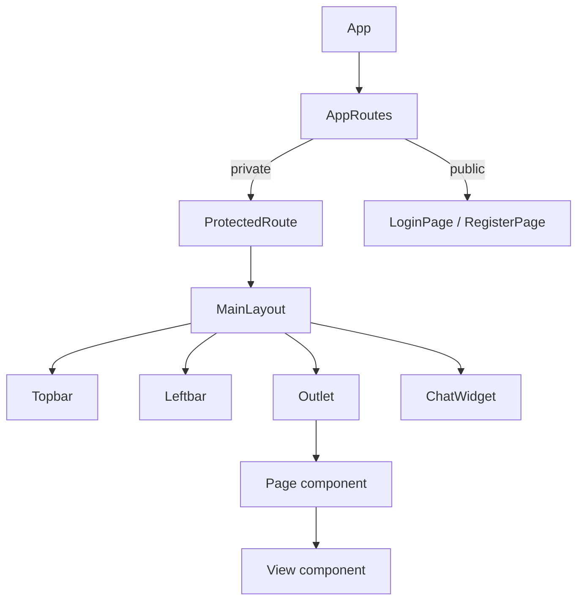
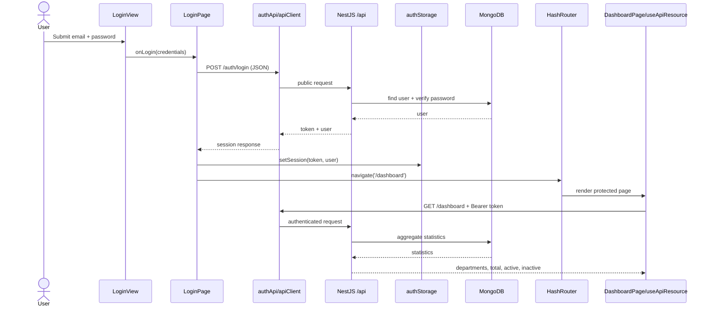
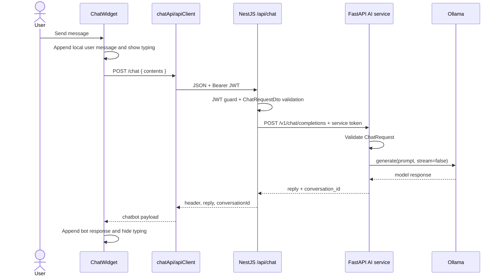

# Architecture Diagrams

The diagrams reflect the current architecture: NestJS is the only public API and FastAPI is the chatbot's private service.

## Folder ownership

The legacy runtime folders `backend/nodejs_ai/` and `backend/python_ai/` are not part of the current application flow.

## Frontend, API, and AI service

## Authenticated-area composition

## Login and dashboard sequence

## Chat sequence

FastAPI provides the boundary for adding RAG, memory, streaming, queues, and provider routing without changing the frontend's public contract.
